# Как вести сайт Science Lounge

Инструкция для организаторов. Программист не нужен: весь контент редактируется в админке.
Время на первый выпуск по этой инструкции: около 20 минут.

Адрес админки: `https://ваш-сайт/admin`. Тот же текст есть внутри админки, раздел «Как вести сайт».

## 1. Вход

Откройте `/admin`, введите почту и пароль, которые вам выдал администратор.

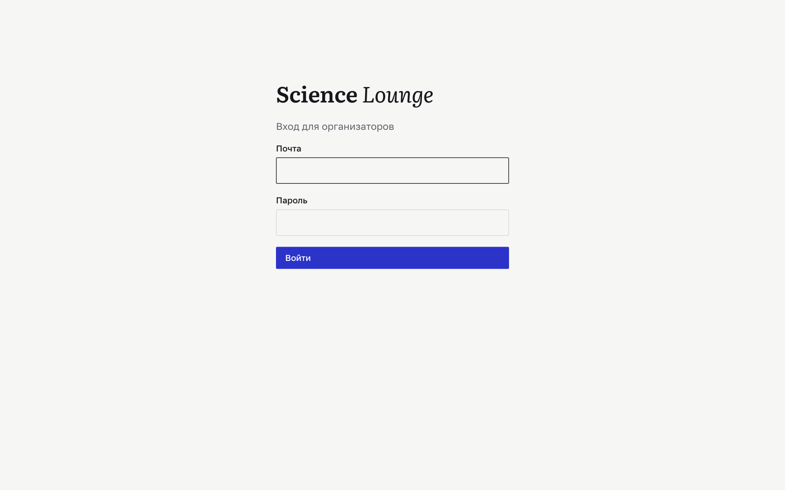

Если забыли пароль, попросите администратора: раздел «Люди», кнопка «Сменить».

**Роли.**

| Роль | Что может |
| --- | --- |
| Редактор | выпуски, лекторы, конференции, команда, загрузка фото |
| Администратор | всё, что редактор, плюс обращения слушателей, настройки сайта, пользователи, копии |

## 2. Главная страница админки

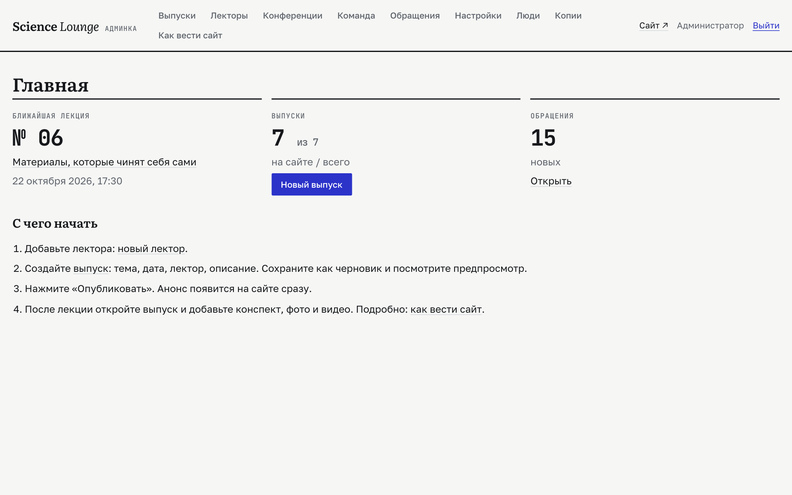

Здесь видно ближайшую лекцию, сколько выпусков на сайте, сколько новых обращений и черновики, которые ждут публикации.

## 3. Один выпуск = одна лекция

Каждая лекция живёт как пронумерованный выпуск журнала: № 01, № 02… Сначала это анонс, после даты лекции та же страница сама становится материалом: конспект, фото, видео. Переключать ничего не нужно.

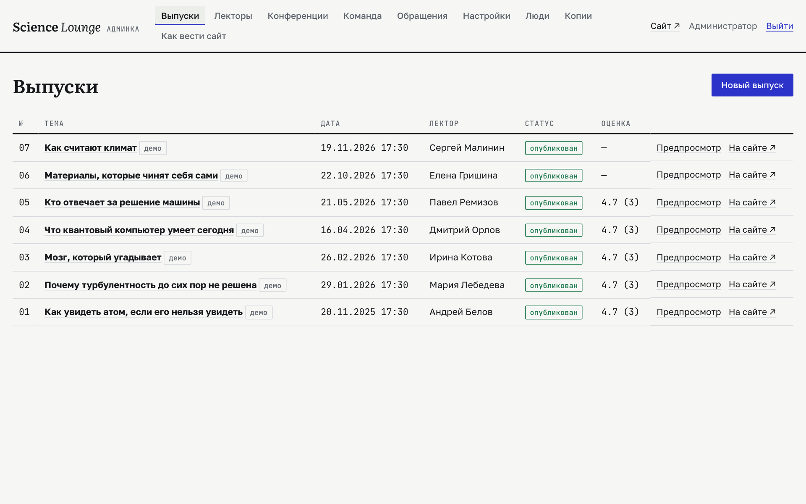

### 3.1. Сначала лектор

Раздел «Лекторы» → «Новый лектор». Отдельной страницы у лектора на сайте нет: одна лекция — один лектор, поэтому его имя, должность, фото и биография показаны прямо на странице выпуска. Анкета нужна, чтобы один человек был в нескольких выпусках и в жюри конференции.

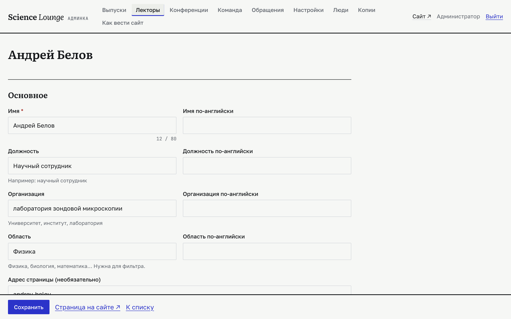

Что заполнить:

1. **Имя, должность, организация.** Например: «научный сотрудник, лаборатория зондовой микроскопии».
2. **Область**: физика, биология, математика… Нужна для порядка в списке в админке.
3. **Портрет.** Кадр 4:5, нейтральный фон. На сайте он чёрно-белый, в цвете при наведении и на странице лектора.
4. **Биография**: 400–800 знаков. Счётчик под полем показывает, сколько уже написано.
5. **Чем известен**: 3–5 фактов, каждый с новой строки.
6. **Ссылки**: сайт, научный профиль, Telegram.

Поля «по-английски» нужны для английской версии. Если не заполнены, на английской странице покажется русский текст.

**Согласие лектора.** До лекции лектор подписывает короткое согласие: запись видео, публикация конспекта, фото, портрета и биографии. Шаблон: `docs/soglasie-lektora.html` (откройте в браузере и распечатайте или сохраните как PDF). Подписанные листы храните у себя.

### 3.2. Новый выпуск

«Выпуски» → «Новый выпуск».

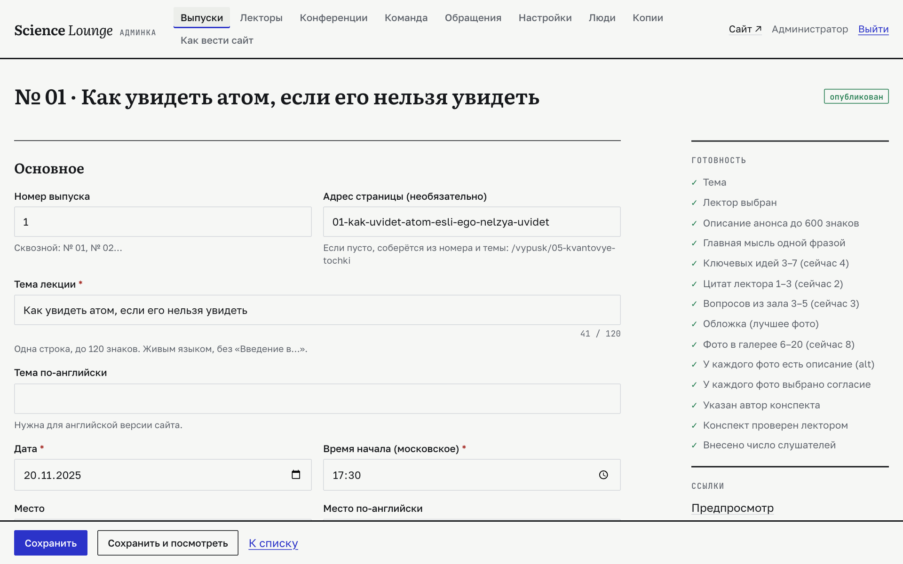

**Основное.**

- **Номер** подставляется сам. Менять нужно, только если вы пропустили номер.
- **Тема лекции**: одна строка до 120 знаков, живым языком. Лучше «Как увидеть атом, если его нельзя увидеть», чем «Введение в сканирующую микроскопию».
- **Дата и время начала** по Москве.
- **Лектор**: отметьте одного или нескольких. Если лектор уже есть в списке, повторно его не создавайте.
- **Области (теги)**: через запятую. По ним строится архив и блок «Похожие выпуски».
- **Особая отметка**: «перенесено», «отменено», «мест нет». Попадает в расписание и на страницу выпуска.

Лекция автоматически становится «прошедшей» через 3 часа после начала.

### 3.3. Анонс

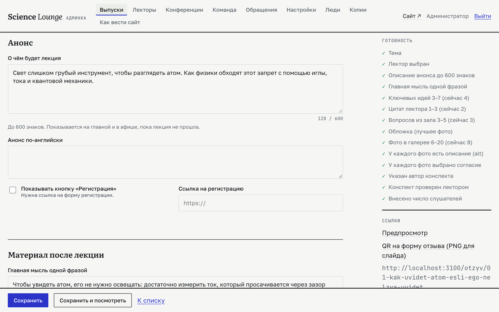

- **О чём будет лекция**: до 600 знаков. Видно на главной, пока лекция не прошла.
- **Кнопка «Регистрация»**: поставьте галочку и вставьте ссылку на форму регистрации. Без ссылки кнопка не покажется.

На странице анонса автоматически есть кнопка «В календарь» (файл `.ics` для Google, Apple, Яндекс Календаря) и форма «Вопрос лектору заранее». Вопросы приходят вам в раздел «Обращения» и в Telegram.

### 3.4. Материал после лекции

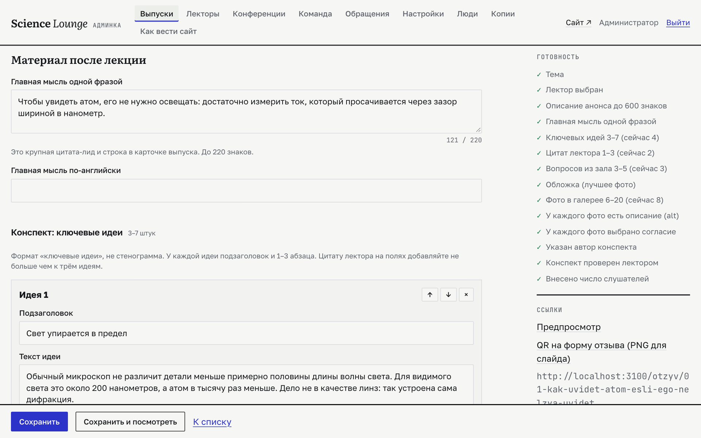

Лучше писать сразу после лекции, пока свежо. Назначьте за это конкретного человека.

1. **Главная мысль одной фразой.** Это крупная цитата-лид и строка в карточке выпуска.
2. **Ключевые идеи**: 3–7 штук. У каждой подзаголовок и 1–3 абзаца. Не стенограмма, а то, что стоит запомнить. Кнопки ↑ ↓ меняют порядок.
3. **Цитата лектора на полях**: добавьте не больше чем к трём идеям. Лучше дословная фраза.
4. **Термины**: слово и короткое определение. Первое вхождение слова в конспекте само подсветится, при наведении или касании появится подсказка. Если слово встречается в другой форме («туннельного эффекта»), впишите формы через запятую или поставьте `*` в конце основы: `туннельн*`.
5. **Вопросы из зала**: 3–5 пар «вопрос — ответ».

**Оформление текста.** Пустая строка делит абзацы. Выделение: `**жирный**`, `*курсив*`, `[текст](https://ссылка)`. Формулы: `$E = mc^2$` внутри строки. Кавычки-ёлочки, тире и неразрывные пробелы сервер расставит при сохранении.

**Чего не писать.** «Погрузитесь в мир науки», «уникальная возможность», «откройте для себя». Пишите конкретно: дата, имя, число людей, что именно сказал лектор.

### 3.5. Видео

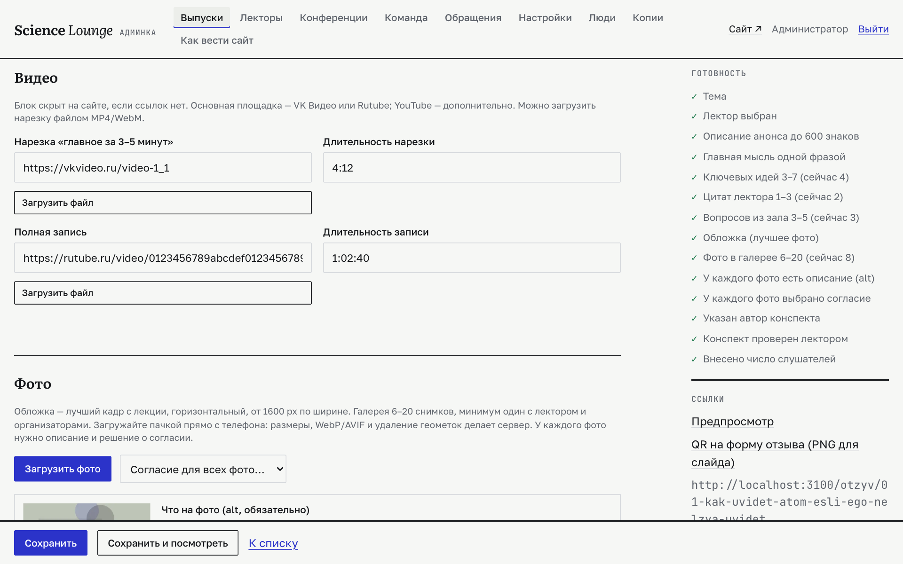

Вставьте ссылку на VK Видео или Rutube. YouTube можно добавить как дополнительную. Плеер подгружается только по клику, поэтому страница остаётся лёгкой. Файл MP4 или WebM до 3–5 минут можно загрузить кнопкой «Загрузить файл».

Если ссылок нет, блок «Видео» на сайте не показывается вообще.

### 3.6. Фото

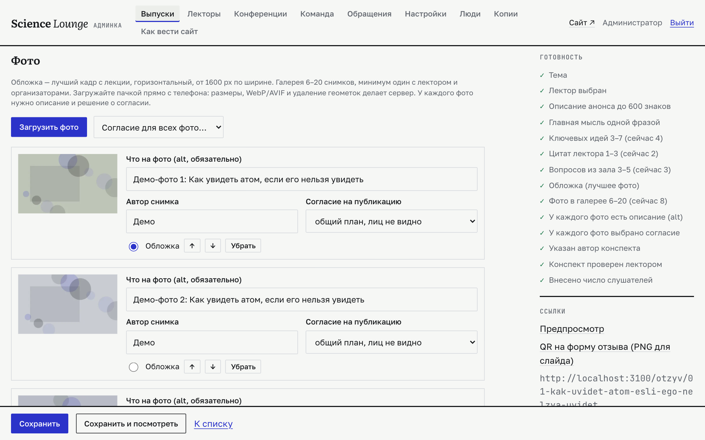

1. Нажмите «Загрузить фото» и выберите сразу несколько снимков (с телефона можно прямо из галереи). Размеры, WebP/AVIF и удаление геометок делает сервер.
2. У **каждого** фото заполните «Что на фото» (описание для слабовидящих) и выберите **согласие**:
   - «да, согласие получено»: ученик узнаваем, родители согласны;
   - «общий план, лиц не видно»;
   - «не проверено»: фото на сайте **не показывается**, пока вы не решите;
   - «нет»: фото не публикуется никогда.
3. Выберите «Обложка» у лучшего кадра с лекции.
4. Нужно 6–20 снимков, среди них хотя бы один с лектором и организаторами.
5. Укажите автора снимка: он подписывается на сайте.

Кнопка «Согласие для всех фото» выставляет значение сразу у всех загруженных кадров.

Выпуск **не опубликуется**, если у какого-то фото нет описания. Он сохранится как черновик с предупреждением.

### 3.7. Материалы и автограф

- **Слайды PDF**: только если лектор разрешил.
- **Что почитать и посмотреть**: рекомендации лектора со ссылками.
- **Автограф выпуска**: лектор от руки пишет одну фразу на листе. Сфотографируйте или отсканируйте лист и загрузите. Это самый «живой» элемент страницы.

### 3.7а. Материал по теме лекции

Необязательный длинный научно-популярный пересказ по теме лекции, на русском и на английском. На странице выпуска он стоит перед формой отзыва, свёрнут под кнопкой «Читать материал» и подписан: «Это не стенограмма: формулировки и реплики не принадлежат лектору». На английской странице он такой же, только на английском.

- Тексты всех лекций лежат в папке `materialy-lektsiy/` (английские — в `materialy-lektsiy/en/`). Команда `npm run content:materials` загружает их в выпуски по номеру из имени файла: `01-…md` → выпуск № 01. Её можно запускать повторно: она перезаписывает текст тем, что сейчас в файлах.
- Поправить текст одного выпуска можно и в админке, в разделе «По теме лекции». Разметка: `## заголовок`, `### подзаголовок`, списки `- пункт` и `1. пункт`, `**жирный**`, `*курсив*`, абзац `[Слайд: …]` — подпись слайда.
- Перед публикацией отправьте текст лектору: шаблон письма — `materialy-lektsiy/pismo-lektoru.md`.

Портреты лекторов (Ратушный, Сурдин, Зубов, Володяев, Горшунов, Намсараев) и фото основателей (Михаил Качай, Владимир Назаров) лежат в `assets/portraits/`. Команда `npm run content:portraits` ставит их лекторам и основателям с такими именами; при полном импорте (`npm run content:import`) это делается само. Чтобы заменить портрет, положите новый файл с тем же именем и запустите команду ещё раз или загрузите фото в админке: «Лекторы» → лектор → «Портрет».

### 3.8. Проверка и итоги

- **Число слушателей**: складывается в цифру на главной.
- **Конспект подготовил(а)**: имя автора.
- **Проверено лектором**: поставьте галочку, когда лектор прочитал и одобрил текст. На странице появится «✓ проверено лектором».
- **Показывать среднюю оценку на сайте**: по умолчанию оценка видна только вам.

### 3.9. Публикация

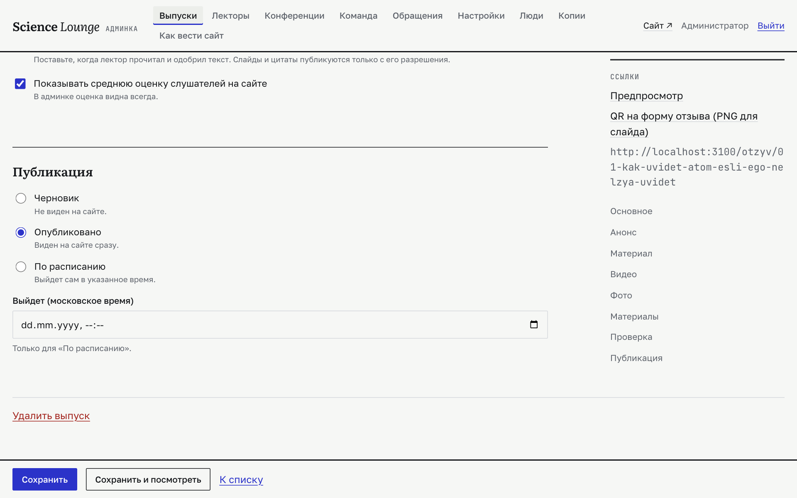

| Вариант | Что происходит |
| --- | --- |
| Черновик | на сайте не виден |
| Опубликовано | виден сразу |
| По расписанию | выйдет сам в указанное время (московское) |

Кнопка «Сохранить и посмотреть» открывает **предпросмотр**: точно так, как увидят посетители.

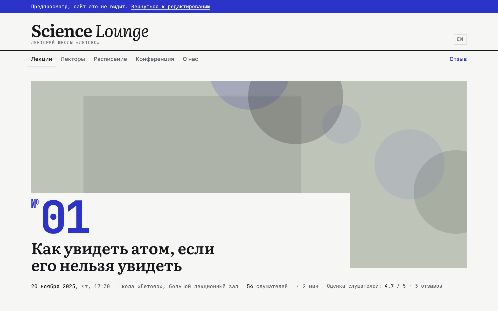

Справа в форме есть **список готовности** и два полезных пункта: «Предпросмотр» и «QR на форму отзыва» (PNG для последнего слайда лекции).

## 4. Отзывы по QR

1. Откройте выпуск, справа нажмите «QR на форму отзыва».
2. Вставьте картинку на последний слайд.
3. Слушатель наводит камеру, на телефоне открывается короткая форма: оценка от 1 до 5 и три необязательных поля. Отправка занимает меньше 30 секунд.

Отзыв анонимный: имя и контакты не спрашиваются. Новый отзыв приходит в Telegram организаторов.

## 5. Конференция National Letovo Engineers

«Конференции» → «Новая конференция». Страница строится из этих данных.

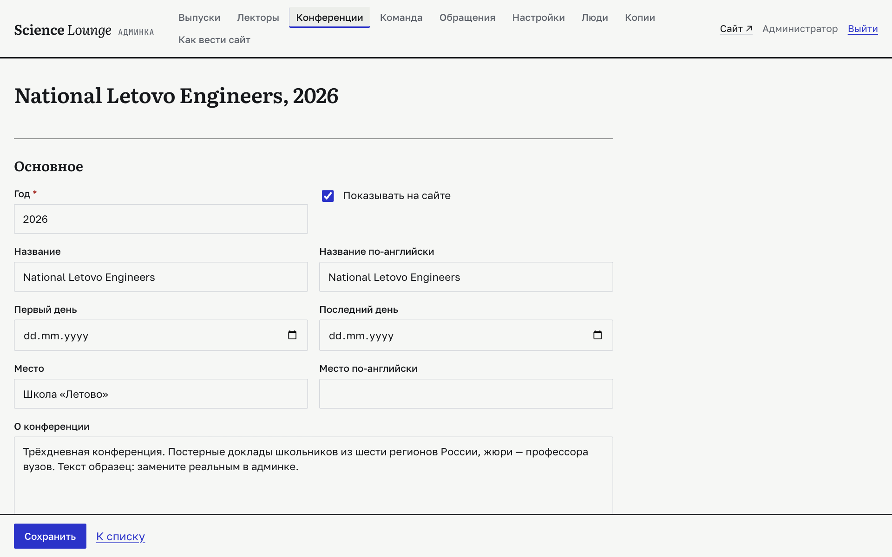

- **Программа по дням**: на каждой строке «время название».
- **Жюри** выбирается из списка лекторов. Сначала добавьте человека как лектора.
- **Регионы**: по одному на строке, как в списке субъектов РФ. Точки на карте России ставятся сами.
- **Постеры**: изображение, название работы, авторы.
- **Фото** и **Итоги**.
- Галочка «Показывать на сайте» включает страницу. На следующий год создайте новую конференцию, старая останется в архиве.

## 6. Команда

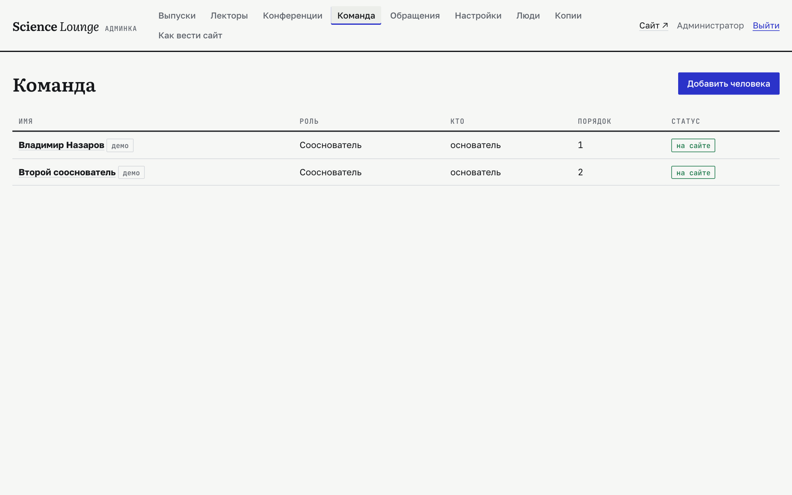

Поле «Кто» задаёт блок на странице «О нас»: «сооснователь» попадает в «Основатели», «помощник команды» в «Сейчас ведут». Порядок задаётся числом.

**Плашки.** В поле «Роль» перечислите роли через запятую: «Сооснователь, CFO» покажет две плашки рядом с именем. Английский вариант тоже через запятую.

**Два места под нынешних организаторов** заведены заранее как «Организатор» и скрыты галочкой «Показывать». Откройте карточку, впишите имя, загрузите фото, включите показ. Если ведут и девушки, и юноши, порядок не важен: блок общий.

«Выпускник» подписывает человека на странице «О нас».

## 6а. Новости науки

Раздел «Новости» → «Новая новость». На сайте это отдельная страница «Новости» (в меню) и три последних новости на главной.

- **Заголовок и краткое содержание**: 2–4 предложения своими словами. Чужой текст целиком не копируем.
- **Источник и ссылка**: название («NobelPrize.org») и адрес, начинающийся с `https://`. Без ссылки новость не публикуйте.
- **Дата** выхода новости, не дата добавления.
- **Картинка** по желанию. Берите только свои или с явным разрешением.
- Галочка «Показывать на сайте» снимается, если новость нужно спрятать, не удаляя.
- Поля «по-английски» нужны для английской версии.

**Новости сами.** Сайт раз в три часа читает открытые ленты (RSS) и добавляет в «Новости» заголовок, одно-два предложения и ссылку на источник. Картинки и полные тексты не копируются. По умолчанию: Элементы, N+1, Naked Science, «Научная Россия» (русский сайт) и ScienceDaily, Phys.org, NASA, NobelPrize.org (английский сайт). Новость из русского источника видна только на русской версии, из английского только на английской.

- В списке такие новости помечены «авто». Лишнюю скройте кнопкой «Скрыть» в её карточке: она пропадёт с сайта и не вернётся.
- Если вы отредактировали автоновость (например, перевели заголовок), она становится вашей: её видно на обеих версиях и она не удаляется сама.
- Автоновости старше 45 дней удаляются, ваши остаются навсегда.
- «Обновить сейчас» в разделе «Новости» запускает подбор вне очереди и показывает, какие источники не открылись.
- Выключить автоподбор или поменять источники: «Настройки» → «Новости науки». Источник это строка `язык|название|адрес ленты`, только https.
- Серверу нужен выход в интернет по https. Если ленты недоступны, новости просто не добавляются, остальной сайт не страдает.

## 7. Обращения (только администратор)

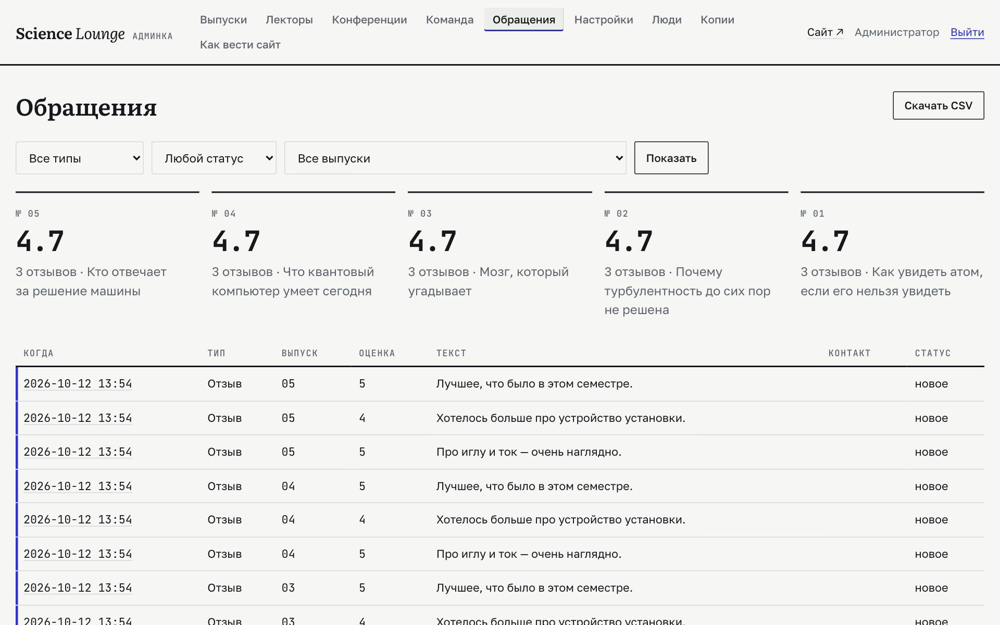

Здесь все формы с сайта: отзывы, вопросы лектору, предложения, сообщения организаторам, просьбы удалить фото.

- Фильтры по типу, статусу и выпуску.
- Статусы: новое → в работе → закрыто.
- Средняя оценка по каждому выпуску наверху.
- Кнопка **«Скачать CSV»** открывается в Excel.
- **Просьбы удалить фото**: срок 10 дней, он показан в таблице. Найдите фото в выпуске, нажмите «Убрать», сохраните, затем закройте обращение.

## 8. Настройки (только администратор)

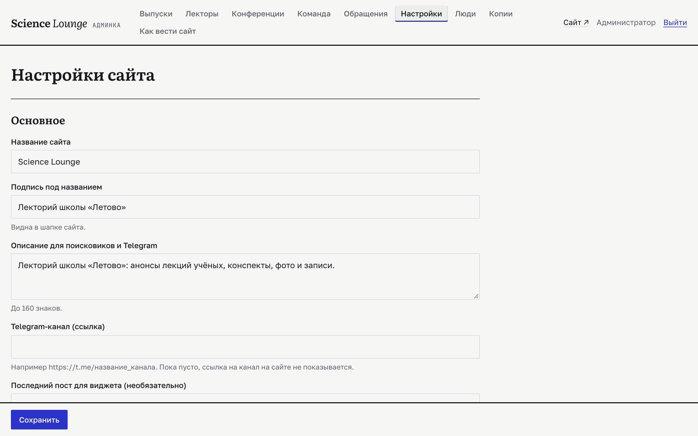

- **Telegram-канал**: ссылка появится в шапке, подвале и в конце каждого выпуска.
- **Почта проекта.**
- **Цифры на главной**: по умолчанию считаются из базы. Если впишете значение (например «300+»), оно покажется вместо расчёта.
- **История проекта, благодарности, блок «Хотите выступить?»**.
- **Оператор персональных данных** и почта: подставляются в политику обработки данных.

## 9. Люди и пароли (только администратор)

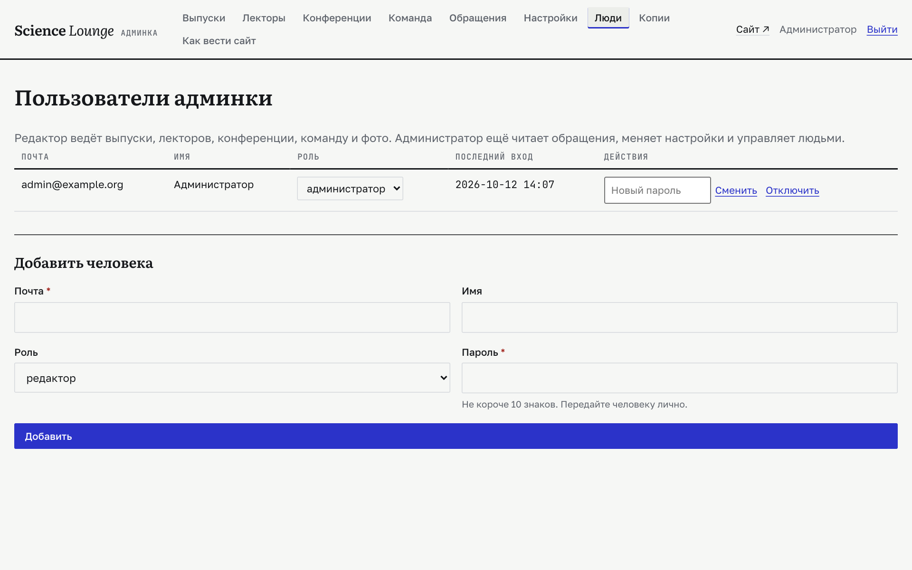

Добавляйте редакторов, меняйте пароли, отключайте тех, кто закончил школу. Последнего администратора отключить нельзя.

## 10. Копии

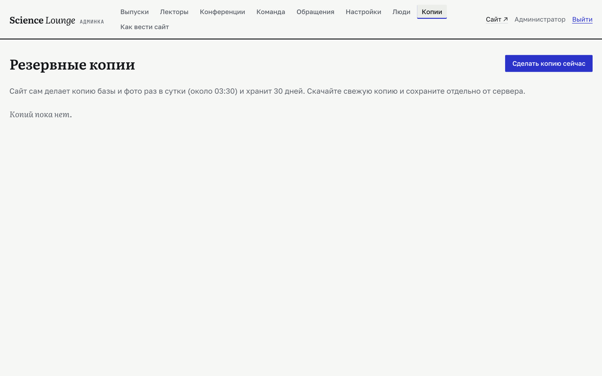

Сайт сам делает копию базы и фото раз в сутки и хранит 30 дней. Раз в месяц скачайте свежую копию и сохраните отдельно от сервера (в облаке школы).

## 11. Передача проекта следующей команде

Когда основатели выпускаются (май 2027):

1. Администратор создаёт учётные записи новой команде («Люди»), роль «редактор» или «администратор».
2. Отключает выпускников.
3. Проверьте, что учётные записи хостинга и домена оформлены на школу или организаторов, а не на разработчика.
4. Раздел «Команда»: отметьте выпускников галочкой «Выпускник».

## 12. Чек-лист перед публикацией выпуска

- [ ] Тема понятная, одна строка.
- [ ] Лектор и дата верные.
- [ ] Главная мысль одной фразой.
- [ ] 3–7 идей, 1–3 цитаты, 3–5 вопросов.
- [ ] Фото: у каждого описание и решение о согласии, есть обложка.
- [ ] Конспект проверен лектором.
- [ ] Слайды опубликованы только с разрешения лектора.
- [ ] Предпросмотр на телефоне выглядит нормально.

## Если что-то пошло не так

| Проблема | Что проверить |
| --- | --- |
| Выпуск не виден на сайте | «Публикация»: не стоит ли «Черновик»; для «По расписанию» время ещё не наступило |
| Фото нет на странице | согласие «не проверено» или «нет»; нет описания |
| Не отправляется форма на сайте | слишком частая отправка с одного адреса, подождите несколько минут |
| Не пришло уведомление в Telegram | «Настройки» → «Отправить проверочное сообщение»; проверьте `TG_BOT_TOKEN` и `TG_CHAT_ID` |
| Забыли пароль | администратор меняет его в разделе «Люди» |
